<div align="center">




</div>

## 👋 About Me
Telecommunications & Computer Engineering student, passionate about networks, wireless systems and cybersecurity. Currently building **AeroMesh**, my graduation project.

## 🛠️ Tech Stack
<div align="center">


</div>

## 🚀 Featured Project
| Project | Description | Status |
|---|---|---|
| **AeroMesh** | Graduation project: wireless mesh networking | 🟢 In progress |

## 💻 Currently
```bash
$ whoami
elias-al-ghazal

$ cat focus.txt
> Computer networks & wireless communication
> Network analysis with Wireshark
> Cybersecurity (white hat)
